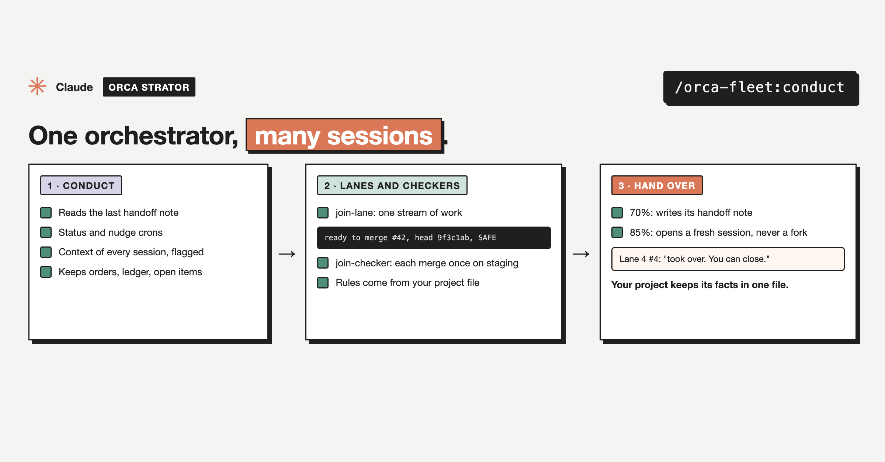

# admiral

Part of [`orca-fleet`](../../README.md), an Orca Strator plugin.



Runs several fleets in one project from above. Each fleet has its own orchestrator (`/orca-fleet:conduct --fleet <id>`); the Admiral starts and closes fleets, gives the person one hourly roll-up, owns what the fleets share (the merge lock on the default branch, numbered claims such as migration numbers, the shared checker pool, CI and account budgets), settles clashes between fleets, and keeps the person's recurring loops. It never builds and routes every order through the orchestrators.

## Use

```
/orca-fleet:admiral                                   start, or take over from the newest Admiral note
/orca-fleet:admiral notes/handoff-admiral-3.md         take over from this note
/orca-fleet:admiral rollup                            the hourly roll-up (the cron runs it)
/orca-fleet:admiral start-fleet agentic "agent layer"  add a fleet and start its orchestrator
/orca-fleet:admiral close-fleet agentic               park a fleet and close its orchestrator
/orca-fleet:admiral loops                             list the recurring jobs it keeps
```

It needs a `fleets` map in `.claude/orca-strator.json` (see the [plugin README](../../README.md#several-fleets-in-one-project)); a project with one fleet needs no Admiral.

## Install

```
/plugin marketplace add mutlumehmet/claude-plugins
/plugin install orca-fleet@mehmetmutlu
```

## About

[](https://www.mehmetmutlu.dev)

Made by Mehmet Mutlu, part of [claude-plugins](../../../../README.md). More of his work at [mehmetmutlu.dev](https://www.mehmetmutlu.dev). If it saves you time, you can [sponsor me on GitHub](https://github.com/sponsors/mutlumehmet) or [buy me a coffee](https://buymeacoffee.com/mutlumehmet).
