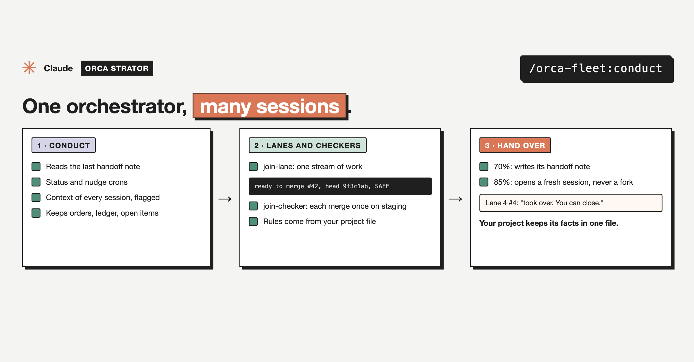

# conduct

Part of [`orca-fleet`](../../README.md), an Orca Strator plugin.



Makes this session the orchestrator of a fleet. It takes over from a handoff note (or starts fresh), recreates the status and nudge crons, tells every lane and checker to report to it, and keeps the orders file. The crons call it back as `conduct status` (context use of every session, with handover flags, and the merge queue) and `conduct nudge` (wakes idle lanes with work left).

## Use

```
/orca-fleet:conduct                              start fresh, or from the newest handoff note
/orca-fleet:conduct notes/handoff-sprint-4.md    take over from this note
/orca-fleet:conduct status                       the status round (the cron runs it)
/orca-fleet:conduct nudge                        the nudge round (the cron runs it)
```

The project config, templates, and what it reads and writes: see the [plugin README](../../README.md).

## Install

```
/plugin marketplace add mutlumehmet/claude-plugins
/plugin install orca-fleet@mehmetmutlu
```

## About

[](https://www.mehmetmutlu.dev)

Made by Mehmet Mutlu, part of [claude-plugins](../../../../README.md). More of his work at [mehmetmutlu.dev](https://www.mehmetmutlu.dev). If it saves you time, you can [sponsor me on GitHub](https://github.com/sponsors/mutlumehmet) or [buy me a coffee](https://buymeacoffee.com/mutlumehmet).
