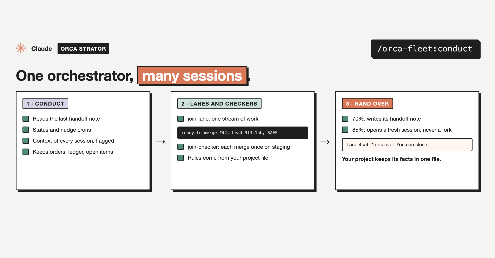

# join-lane

Part of [`orca-fleet`](../../README.md), an Orca Strator plugin.



Makes this session a lane: it reads the rules file and its handoff note, reports in to whoever its reporting line names, builds one change at a time, pushes once per finished change, and sends `ready to merge #N, head <sha>, SAFE` when a PR is ready.

## Who a lane reports to

| Line | Reports to | Asks questions of |
|---|---|---|
| `orchestrator` | The fleet's orchestrator | The orchestrator |
| `parent` | The session that started it | Its parent |
| `independent` | Nobody: it works with the person in its own window | The person |

The line comes from the launch prompt, then the handoff note's `## Reports to`, then a "report to me" from an orchestrator or the person. With none of these, the lane asks the person. A note written before these lines existed names an orchestrator, so it keeps working as it did. Parent and independent lanes contact the orchestrator only to coordinate shared files or numbered resources.

Start one with the parent's address filled in for you (from inside the parent session):

```
python3 -I "${CLAUDE_PLUGIN_ROOT}/scripts/successor.py" --name "Lane 1 · page access" --account work --reports-to parent \
  --cwd <project folder> --prompt "/orca-fleet:join-lane <brief>"
```

To release a running lane, tell it `/orca-fleet:join-lane reports-to independent`, or have its parent send `reports-to: independent`. A release changes who it talks to, never what it may merge: that stays in your rules file.

## Use

```
/orca-fleet:join-lane
/orca-fleet:join-lane notes/handoff-lane-2-3.md
/orca-fleet:join-lane reports-to independent
```

The project config, templates, and what it reads and writes: see the [plugin README](../../README.md).

## Install

```
/plugin marketplace add mutlumehmet/claude-plugins
/plugin install orca-fleet@mehmetmutlu
```

## About

[](https://www.mehmetmutlu.dev)

Made by Mehmet Mutlu, part of [claude-plugins](../../../../README.md). More of his work at [mehmetmutlu.dev](https://www.mehmetmutlu.dev). If it saves you time, you can [sponsor me on GitHub](https://github.com/sponsors/mutlumehmet) or [buy me a coffee](https://buymeacoffee.com/mutlumehmet).
