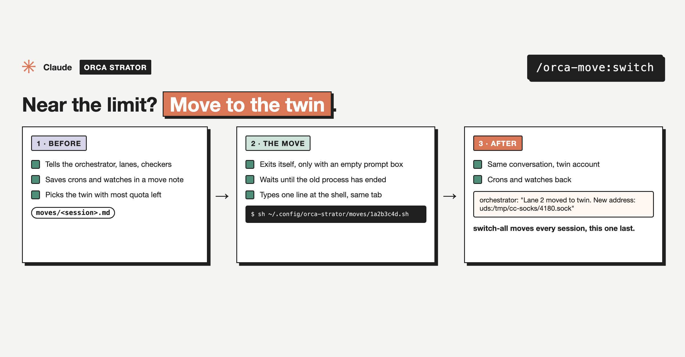

# after-move

Part of [`orca-move`](../../README.md), an [Orca Strator](../../README.md) plugin.



Runs in the resumed session (the resume line passes it as the first prompt). It reads the move note, recreates the crons and background work, and sends the new `uds:` message address to every session on the note's list, checking each one's current address first.

## Use

```
/orca-move:after-move
```

How the whole move works, setup, what it reads and writes, and what it never does: see the [plugin README](../../README.md).

## Install

```
/plugin marketplace add mutlumehmet/claude-plugins
/plugin install orca-move@mehmetmutlu
```

## About

[](https://www.mehmetmutlu.dev)

Made by Mehmet Mutlu, part of [claude-plugins](../../../../README.md). More of his work at [mehmetmutlu.dev](https://www.mehmetmutlu.dev). If it saves you time, you can [sponsor me on GitHub](https://github.com/sponsors/mutlumehmet) or [buy me a coffee](https://buymeacoffee.com/mutlumehmet).
