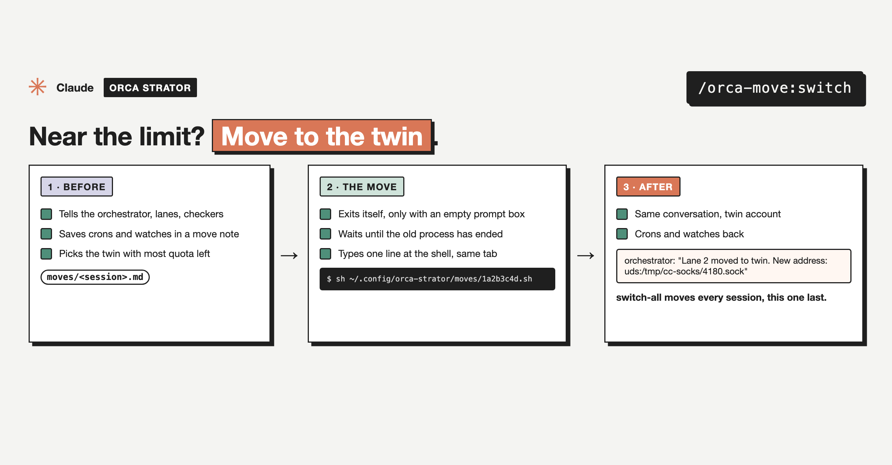

# switch-all

Part of [`orca-move`](../../README.md), an [Orca Strator](../../README.md) plugin.



Moves every live session of this account to a twin account. It shows a dry run of `move-all` and hands you one `!` line that ends each idle session (or one waiting at the usage limit) and resumes it in its own Terminal tab, in seconds, even when the account is already out of quota. Busy sessions get a short wait; a session waiting on a permission prompt is skipped unless you add `--force`. This session moves last. Asking each session to run `switch` itself stays as the fallback.

## Use

```
/orca-move:switch-all
/orca-move:switch-all workb
```

How the whole move works, setup, what it reads and writes, and what it never does: see the [plugin README](../../README.md).

## Install

```
/plugin marketplace add mutlumehmet/claude-plugins
/plugin install orca-move@mehmetmutlu
```

## About

[](https://www.mehmetmutlu.dev)

Made by Mehmet Mutlu, part of [claude-plugins](../../../../README.md). More of his work at [mehmetmutlu.dev](https://www.mehmetmutlu.dev). If it saves you time, you can [sponsor me on GitHub](https://github.com/sponsors/mutlumehmet) or [buy me a coffee](https://buymeacoffee.com/mutlumehmet).
