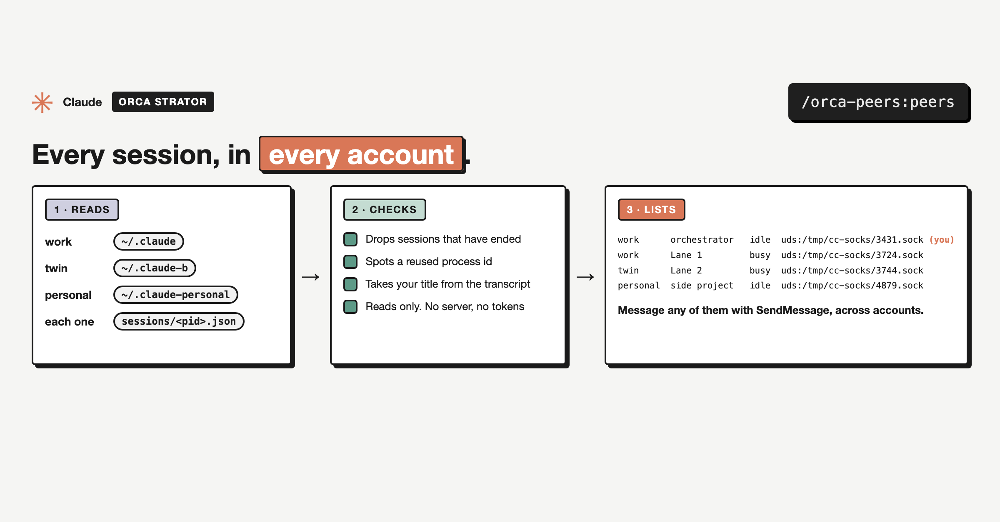

# orca-peers

Part of **Orca Strator**, a set of small plugins for running many Claude Code sessions at once. Each one installs on its own. **Most people install the bundle, [`orca-strator`](../orca-strator), which includes this one, then type `/orca`.**



| Skill | What it does |
|---|---|
| [`peers`](skills/peers) | Lists every live Claude Code session on this machine, in every account, with how full its context is and the address to message it across accounts |

## Install

```
/plugin marketplace add mutlumehmet/claude-plugins
/plugin install orca-peers@mehmetmutlu
```

## About

[](https://www.mehmetmutlu.dev)

Made by Mehmet Mutlu, part of [claude-plugins](../../README.md). More of his work at [mehmetmutlu.dev](https://www.mehmetmutlu.dev). If it saves you time, you can [sponsor me on GitHub](https://github.com/sponsors/mutlumehmet) or [buy me a coffee](https://buymeacoffee.com/mutlumehmet).
