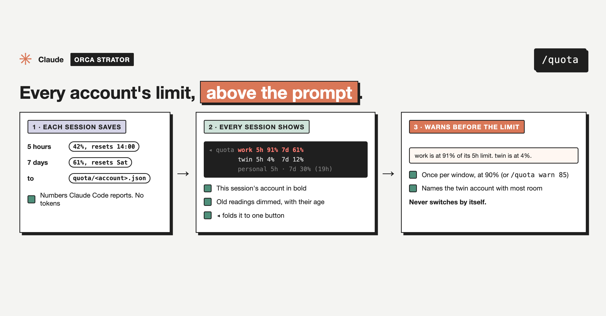

# orca-quota

Part of **Orca Strator**, a set of small plugins for running many Claude Code sessions at once. Each one installs on its own. **Most people install the bundle, [`orca-strator`](../orca-strator), which includes this one, then type `/orca`.**

`orca-quota` was called `orca-accounts` until 0.1.x (renamed 27 October 2026, so the name says what it does).

A Claude Code mod that shows the 5-hour and 7-day usage of every Claude account you use on this machine, in one band above the prompt, and warns you once before the account you are on hits its limit.



## What it does

- **The band**: one line above the prompt, for example `◂ quota work 5h 91% ↻40m  7d 61% ↻3d │ twin 5h 4% ↻4h10m  7d 12% ↻5d │ personal 5h ·  7d 30% ↻14h (2h)`, with a dim bar between accounts. Each window shows its time to reset after `↻` (`↻40m`, `↻4h10m`, `↻14h`, `↻3d`). The account this session runs on is bold, an account at or over the warning level is red, and a reading older than an hour is dimmed with its age in brackets. `·` means Claude Code did not report that window for the account.
- **Fold it**: `◂` folds the band to one `quota ▸` button; press it to open the band again.
- **`/quota`**: every account with its usage, when each window resets, and how old each reading is.
- **The warning**: when this account passes the warning level (85% by default) in either window, one toast says so and names the account in the same family with the most room, for example `work is at 91% of its 5h limit. twin is at 4%.` It warns again only after usage drops back below the level and crosses it again.
- **Resets**: a window whose reset time has passed shows 0%, even if no session has reported since.

- **Auto refresh (on by default)**: an account on this machine with no session open for over an hour gets one tiny headless prompt (`claude -p` on Haiku, in that account's own config dir) every hour or so, so its reading stays current. Each run costs that account a few tokens and starts its 5-hour window if none is running. `/quota refresh off` turns it off.
- **Auto move (opt in)**: with `/quota auto on`, the first session of an account to pass the warning level moves the whole account to the twin with most room: it claims the account (a claim file in `~/.config/orca-strator/moves/`, so the other sessions leave it alone) and runs [`orca-move`](../orca-move)'s `move-all`, which ends and resumes every session of the account in its own tab, this one last, before any of them reaches the hard limit. With an older orca-move (no `move-all`), it moves just this session with `/orca-move:switch <twin>`. Off by default; it moves once per session, and never to a twin that is itself over the warning level.

Without auto move it never switches accounts: it warns, and you move with `/orca-move:switch`.

## Commands

```
/quota               every account, reset times, age of each reading, and these commands
/quota warn <50-99>  warn when this account passes that percent (default 85)
/quota hide          fold the band to one button
/quota show          open the band again
/quota auto on       at the warning level, move every session of this account to the twin with most room
/quota auto off      only warn (the default)
/quota refresh on    refresh accounts idle for over an hour with one tiny prompt each (the default)
/quota refresh off   never run anything in another account
```

Defaults for every account can live in `~/.config/orca-strator/config.yaml` as `auto_move: true`, `warn_percent: 85` and `auto_refresh: false` (the `/orca` setup screen writes them). `/quota warn`, `/quota auto`, `/quota refresh` and the fold are kept per config directory (per account), in Claude Code's plugin store.

## How the numbers get there

Claude Code itself tells each session how much of its own account's 5-hour and 7-day limits are used. The mod saves that reading for the session's account to `~/.config/orca-strator/quota/<account>.json`, and every session, in any account, reads all of those files. So:

- An account with a session open is current.
- An account named in the accounts file that has never had a session shows as `workc 5h · 7d · (never)`, dimmed, so you can see the seat exists; its first reply in a session fills it in.
- An account with no session open is refreshed by auto refresh: every 15 minutes each session looks for an account whose reading is over an hour old, writes a claim file in `~/.config/orca-strator/quota/refresh/` (so no other session refreshes it in that hour), and runs one prompt in it. That run's own copy of the mod saves the reading; it carries `ORCA_QUOTA_REFRESH=1` so it never starts runs itself. An account never read is skipped (it may not be signed in), and so is this session's own.
- With auto refresh off, an account with no session open keeps its last reading. That reading stays right until you use the account again, unless you use it elsewhere: claude.ai on the web, the desktop chat and the phone apps share the same limits but do not write readings. The dimmed age tells you how old it is.

## Accounts and families

With no setup, each config directory is an account: `~/.claude` is `default`, `~/.claude-<name>` is `<name>`, and the one in `$CLAUDE_CONFIG_DIR` is named after its folder.

To give accounts your own names and to say which accounts are twins (two logins sharing the same projects, so a session can move between them), point the shared Orca Strator config at an accounts file. Optional.

`~/.config/orca-strator/config.yaml`:

```yaml
accounts_file: ~/.claude/accounts.json
```

The accounts file:

```json
{
  "accounts": {
    "work":     { "configDir": "~/.claude" },
    "twin":     { "configDir": "~/.claude-twin", "twinOf": "work" },
    "personal": { "configDir": "~/.claude-personal" }
  }
}
```

| Key | What it is for | Required | Default |
|---|---|---|---|
| `accounts_file` (config.yaml) | Path to the accounts file | No | Accounts named after their folders |
| `accounts.<id>.configDir` | The account's Claude Code config directory | Yes, per account | |
| `accounts.<id>.twinOf` | The account this one is a twin of; twins form one family, and the warning only suggests accounts in the same family | No | Its own family |

`orca-peers` reads the same file.

## What it reads and does

- **Reads**: the usage Claude Code reports to the session (`session.measure` and `$.session.usage()`), `HOME` and `CLAUDE_CONFIG_DIR`, the Orca Strator config and accounts file, the readings in `~/.config/orca-strator/quota/`, and `ORCA_QUOTA_REFRESH`.
- **Keeps**: one small JSON file per account in `~/.config/orca-strator/quota/` (percent and reset time per window, and when it was read), and one claim file per refreshed account in `quota/refresh/` (when and by which session); the warning level, auto move, auto refresh, the fold and whether the first-run tip was shown, in Claude Code's plugin store.
- **Does**: draws the band, answers `/quota`, shows the warning toast and, once, a tip saying where the controls are.
- **Hooks**: `session.start` (registers `/quota`, saves the first reading), `session.measure` (saves and warns when the usage changes), `command.run` for `/quota`, `ui.render` on the band above the prompt.
- **Runs**: `claude -p "Reply with the single word: ok" --model haiku` in another account's config dir, with auto refresh on (the default), at most once an hour per account, for an account idle over an hour. `/orca-move:switch <twin>`, only with `/quota auto on`, once per session, when this account passes the warning level.
- **Never**: reads login tokens or credentials, calls any API itself (the refresh prompt goes through Claude Code, signed in as that account), refreshes an account never read, switches accounts unless you turned auto move on, or sends anything else anywhere.
- **Privacy**: see [PRIVACY.md](../../PRIVACY.md).

## Install

Needs Claude Code 2.1.310 or later (usage in `session.measure`). Tested on 2.1.310.

```
/plugin marketplace add mutlumehmet/claude-plugins
/plugin install orca-quota@mehmetmutlu
```

Install it in every account you use, so each one writes its own reading. A mod runs inside Claude Code with your permissions. Read the code before you install any mod.

## Known gaps

- An account only reports the windows its plan has; some report only the 7-day window.
- Usage on claude.ai, the desktop chat or the phone apps is not seen until a Claude Code session (or an auto refresh) runs on that account again.
- Auto refresh covers only accounts on this machine; another machine refreshes its own.
- Readings from before you set `accounts_file` stay under their folder names until you delete them from `~/.config/orca-strator/quota/`.

## About

[](https://www.mehmetmutlu.dev)

Made by Mehmet Mutlu, part of [claude-plugins](../../README.md). More of his work at [mehmetmutlu.dev](https://www.mehmetmutlu.dev). If it saves you time, you can [sponsor me on GitHub](https://github.com/sponsors/mutlumehmet) or [buy me a coffee](https://buymeacoffee.com/mutlumehmet).
