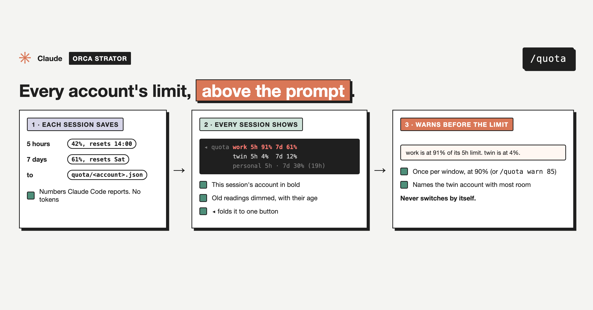

# orca-quota

Part of **Orca Strator**, a set of small plugins for running many Claude Code sessions at once. Each one installs on its own.

`orca-quota` was called `orca-accounts` until 0.1.x (renamed 27 October 2026, so the name says what it does). Installed `orca-accounts` updates to an empty plugin that installs this one.

A Claude Code mod that shows the 5-hour and 7-day usage of every Claude account you use on this machine, in one band above the prompt, and warns you once before the account you are on hits its limit.



## What it does

- **The band**: one line above the prompt, for example `◂ quota work 5h 91% 7d 61%   twin 5h 4% 7d 12%   personal 5h · 7d 30% (2h)`. The account this session runs on is bold, an account at or over the warning level is red, and a reading older than an hour is dimmed with its age. `·` means Claude Code did not report that window for the account.
- **Fold it**: `◂` folds the band to one `quota ▸` button; press it to open the band again.
- **`/quota`**: every account with its usage, when each window resets, and how old each reading is.
- **The warning**: when this account passes the warning level (90% by default) in either window, one toast says so and names the account in the same family with the most room, for example `work is at 91% of its 5h limit. twin is at 4%.` It warns again only after usage drops back below the level and crosses it again.
- **Resets**: a window whose reset time has passed shows 0%, even if no session has reported since.

- **Auto move (opt in)**: with `/quota auto on`, a session that passes the warning level moves itself to the twin with most room: the mod runs `/orca-move:switch <twin>`, and [`orca-move`](../orca-move) does the move (tells its peers, saves its crons, resumes the same conversation in the same tab). Off by default; it moves once per session, and never to a twin that is itself over the warning level.

Without auto move it never switches accounts: it warns, and you move with `/orca-move:switch`.

## Commands

```
/quota               every account, reset times, age of each reading, and these commands
/quota warn <50-99>  warn when this account passes that percent (default 90)
/quota hide          fold the band to one button
/quota show          open the band again
/quota auto on       move this session to the twin with most room by itself at the warning level
/quota auto off      only warn (the default)
```

`/quota warn`, `/quota auto` and the fold are kept per config directory (per account), in Claude Code's plugin store.

## How the numbers get there

Claude Code itself tells each session how much of its own account's 5-hour and 7-day limits are used. The mod saves that reading for the session's account to `~/.config/orca-strator/quota/<account>.json`, and every session, in any account, reads all of those files. So:

- An account with a session open is current.
- An account with no session open keeps its last reading. That reading stays right until you use the account again, unless you use it elsewhere: claude.ai on the web, the desktop chat and the phone apps share the same limits but do not write readings. The dimmed age tells you how old it is.

## Accounts and families

With no setup, each config directory is an account: `~/.claude` is `default`, `~/.claude-<name>` is `<name>`, and the one in `$CLAUDE_CONFIG_DIR` is named after its folder.

To give accounts your own names and to say which accounts are twins (two logins sharing the same projects, so a session can move between them), point the shared Orca Strator config at an accounts file. Optional.

`~/.config/orca-strator/config.yaml`:

```yaml
accounts_file: ~/.claude/accounts.json
```

The accounts file:

```json
{
  "accounts": {
    "work":     { "configDir": "~/.claude" },
    "twin":     { "configDir": "~/.claude-twin", "twinOf": "work" },
    "personal": { "configDir": "~/.claude-personal" }
  }
}
```

| Key | What it is for | Required | Default |
|---|---|---|---|
| `accounts_file` (config.yaml) | Path to the accounts file | No | Accounts named after their folders |
| `accounts.<id>.configDir` | The account's Claude Code config directory | Yes, per account | |
| `accounts.<id>.twinOf` | The account this one is a twin of; twins form one family, and the warning only suggests accounts in the same family | No | Its own family |

`orca-peers` reads the same file.

## What it reads and does

- **Reads**: the usage Claude Code reports to the session (`session.measure` and `$.session.usage()`), `HOME` and `CLAUDE_CONFIG_DIR`, the Orca Strator config and accounts file, and the readings in `~/.config/orca-strator/quota/`.
- **Keeps**: one small JSON file per account in `~/.config/orca-strator/quota/` (percent and reset time per window, and when it was read); the warning level, the fold and whether the first-run tip was shown, in Claude Code's plugin store.
- **Does**: draws the band, answers `/quota`, shows the warning toast and, once, a tip saying where the controls are.
- **Hooks**: `session.start` (registers `/quota`, saves the first reading), `session.measure` (saves and warns when the usage changes), `command.run` for `/quota`, `ui.render` on the band above the prompt.
- **Runs**: `/orca-move:switch <twin>`, only with `/quota auto on`, once per session, when this account passes the warning level.
- **Never**: reads login tokens or credentials, calls any API, switches accounts unless you turned auto move on, or sends anything anywhere.
- **Privacy**: see [PRIVACY.md](../../PRIVACY.md).

## Install

Needs Claude Code 2.1.310 or later (usage in `session.measure`). Tested on 2.1.310.

```
/plugin marketplace add mutlumehmet/claude-plugins
/plugin install orca-quota@mehmetmutlu
```

Install it in every account you use, so each one writes its own reading. A mod runs inside Claude Code with your permissions. Read the code before you install any mod.

## Known gaps

- An account only reports the windows its plan has; some report only the 7-day window.
- Usage on claude.ai, the desktop chat or the phone apps is not seen until a Claude Code session runs on that account again.
- Readings from before you set `accounts_file` stay under their folder names until you delete them from `~/.config/orca-strator/quota/`.

## About

[](https://www.mehmetmutlu.dev)

Made by Mehmet Mutlu, part of [claude-plugins](../../README.md). More of his work at [mehmetmutlu.dev](https://www.mehmetmutlu.dev). If it saves you time, you can [sponsor me on GitHub](https://github.com/sponsors/mutlumehmet) or [buy me a coffee](https://buymeacoffee.com/mutlumehmet).
