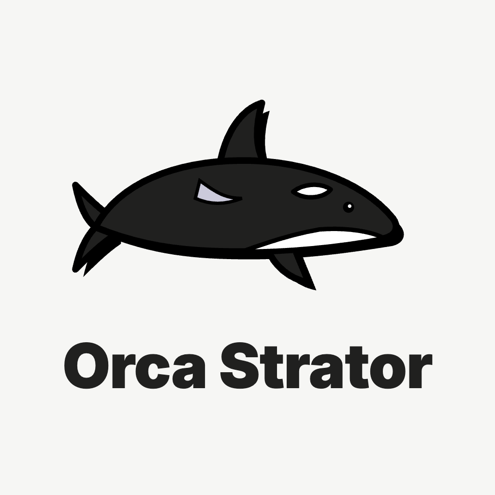
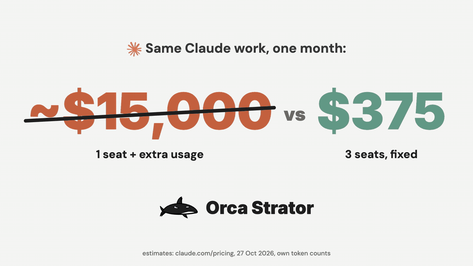
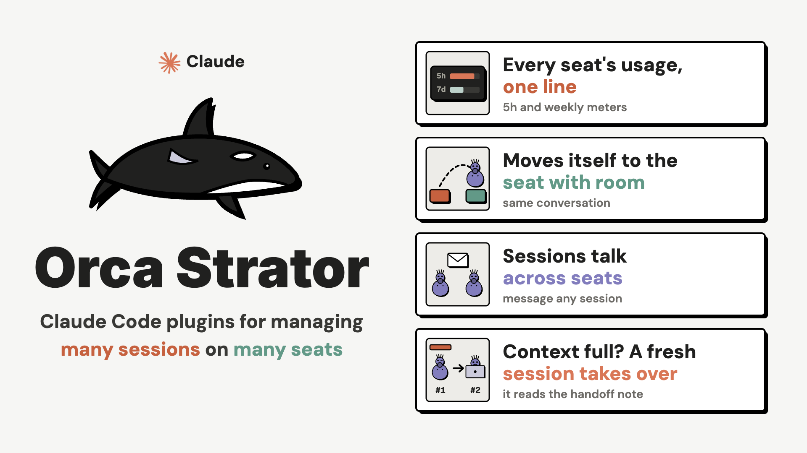

# orca-strator

**Orca Strator** in one install: tools for people who run many Claude Code sessions at once, often under more than one Claude login. This plugin holds no code of its own. It lists the four Orca Strator plugins as dependencies, so installing it installs them all.







**Why:** one Claude seat plus extra usage at API rates came to roughly $15,000 to $20,000 a month for the author's work, by his own token counts; three Team seats used fully cost $375 a month, fixed. More seats is cheaper, but every seat has its own 5 hour and weekly limit. Orca Strator does the juggling: it shows every seat's usage, moves a session to the seat with room (by itself with `/quota auto on`), lets sessions on different seats talk, and hands over to a fresh session when context fills.

The full story, with the video: [mehmetmutlu.dev/projects/orca-strator](https://www.mehmetmutlu.dev/projects/orca-strator).


## Start here: `/orca`

One command, buttons for the rest. `/orca` checks the setup (plugins in this account, accounts and twins, a fleet config in this project), lets you change the settings (auto move on or off, the warning level) and starts this session in the right role: **orchestrator**, **lane**, **checker**, or **just this session**. `/orca status` shows every seat, session and context level on one screen; `/orca help` lists every command. In a project with a fleet config (`.claude/orca-strator.json`) a new session says so in one line, and never starts anything by itself.

## The parts

| Plugin | What it does | Use it when |
|---|---|---|
| [`orca-peers`](../orca-peers) | `/peers` lists every live session in every account, with its message address and how full its context is | You message sessions in other accounts, or want to see which ones need a handover |
| [`orca-quota`](../orca-quota) | Every account's 5-hour and 7-day usage above the prompt, `/quota`, and a warning before the limit | You have more than one Claude login |
| [`orca-move`](../orca-move) | Moves a live session (or all of them) to a twin account, saving its crons and telling the sessions it works with | One login nears its limit and a twin has room |
| [`orca-fleet`](../orca-fleet) | An orchestrator, lanes and checkers on one project, with handovers to a fresh session when context fills | You run a fleet of sessions on one piece of work |

## Mix and match

Each plugin works alone, and each one uses the others when they are there:

- `orca-peers` alone: a list of sessions across accounts.
- `orca-quota` alone: the usage band and `/quota`.
- `orca-move` uses `orca-quota` to pick the twin with most room, and `orca-peers` to find who to tell.
- `orca-fleet` needs `orca-peers` (addresses and context use); it uses `orca-move` and [`watch-ci`](../dev-workflow/skills/watch-ci) when installed.

To pick only some, install each by name, for example `/plugin install orca-peers@mehmetmutlu`.

## Twin accounts, in one paragraph

A twin is a second Claude login whose config directory shares the first one's `projects/` folder, so `claude --resume <id>` under either login opens the same conversation. Each login has its own usage limits; moving a session to its twin keeps the conversation and uses the twin's limits. Every login is logged in by you, once; none of these plugins reads or copies login tokens. Name your accounts and twins in one file, `~/.config/orca-strator/config.yaml` with `accounts_file: <path to a JSON file>`, described in the [`orca-quota` README](../orca-quota#accounts-and-families).

## Install

```
/plugin marketplace add mutlumehmet/claude-plugins
/plugin install orca-strator@mehmetmutlu
```

Install it in every account you use. Needs Claude Code 2.1.310 or later; moves and handovers open Terminal.app tabs on macOS, and give you a line to paste elsewhere.

## Good to know

- **Removing `orca-strator` leaves the four plugins installed.** Uninstall each by name to remove it.
- `orca-quota` and `orca-move` each include a small mod (code that runs inside Claude Code). Read the code before you install any mod.

## About

[](https://www.mehmetmutlu.dev)

Made by Mehmet Mutlu, part of [claude-plugins](../../README.md). More of his work at [mehmetmutlu.dev](https://www.mehmetmutlu.dev). If it saves you time, you can [sponsor me on GitHub](https://github.com/sponsors/mutlumehmet) or [buy me a coffee](https://buymeacoffee.com/mutlumehmet).
