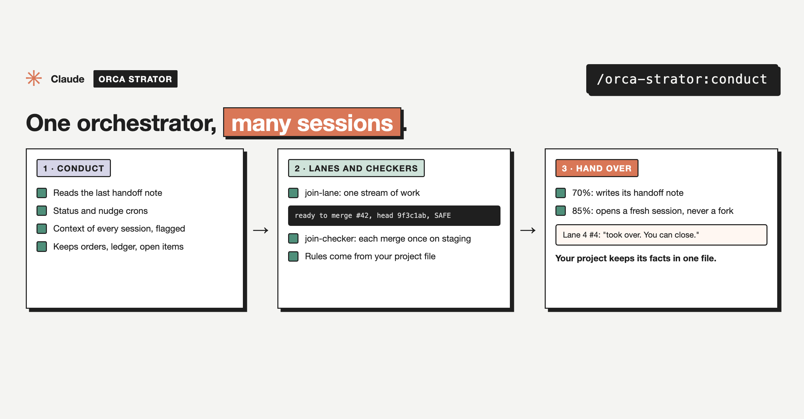

# join-lane

Part of [`orca-strator`](../../README.md), an Orca Strator plugin.



Makes this session a lane: it reads the rules file and its handoff note, reports to the orchestrator, builds one change at a time, pushes once per finished change, and sends `ready to merge #N, head <sha>, SAFE` when a PR is ready.

## Use

```
/orca-strator:join-lane
/orca-strator:join-lane notes/handoff-lane-2-3.md
```

The project config, templates, and what it reads and writes: see the [plugin README](../../README.md).

## Install

```
/plugin marketplace add mutlumehmet/claude-plugins
/plugin install orca-strator@mehmetmutlu
```

## About

[](https://www.mehmetmutlu.dev)

Made by Mehmet Mutlu, part of [claude-plugins](../../../../README.md). More of his work at [mehmetmutlu.dev](https://www.mehmetmutlu.dev). If it saves you time, you can [sponsor me on GitHub](https://github.com/sponsors/mutlumehmet) or [buy me a coffee](https://buymeacoffee.com/mutlumehmet).
